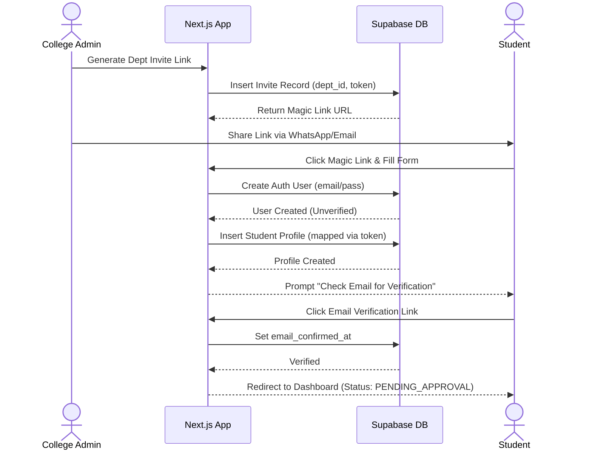
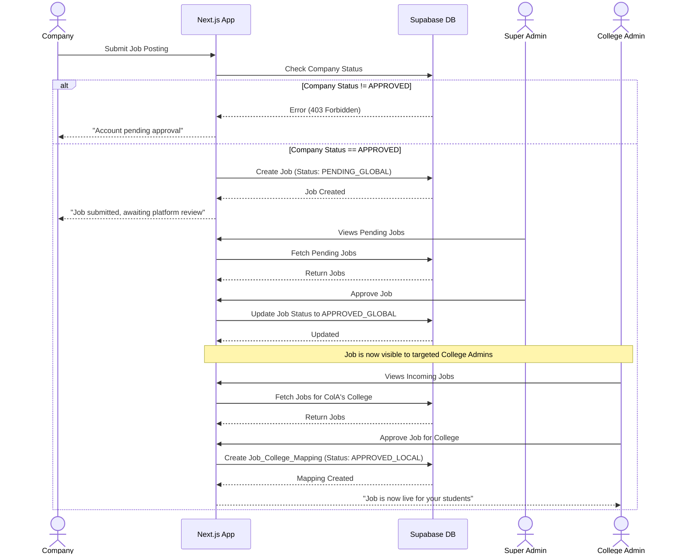
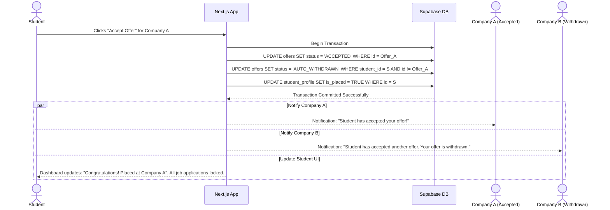

# DOCUMENT 10: Sequence Diagrams

*Rendered using Mermaid.js syntax. You can copy/paste these into any Markdown viewer that supports Mermaid (like Notion, GitHub, or Mermaid Live Editor) to see the visual diagrams.*

**Diagram 1: Student Registration & College Mapping Flow**

**Diagram 2: Job Posting Dual-Approval Flow**

**Diagram 3: Offer Acceptance & Auto-Withdrawal State Machine**

