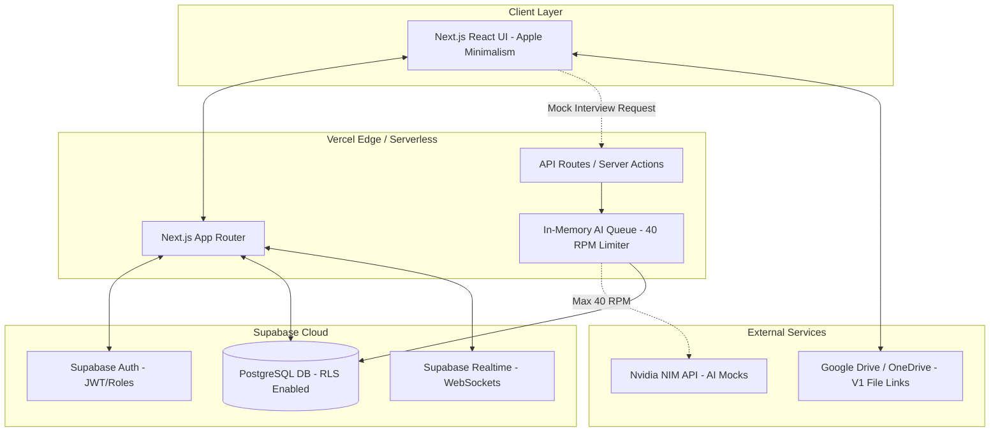

# DOCUMENT 13: System Architecture

### **13.1 Architectural Style**

**Next.js App Router (BFF - Backend for Frontend) + Supabase (SaaS DB/Auth).**
Because the team consists of mostly junior developers, we strictly avoid a decoupled frontend/backend setup (like separate React + Node.js servers). Next.js API routes will act as a secure proxy, specifically to hide the Nvidia NIM API key and handle the 40 RPM rate-limiting queue.

### **13.2 Architecture Diagram**

### **13.3 Key Architectural Decisions**

1. **No ORM:** We will use **`@supabase/ssr`** directly. Introducing Prisma or Drizzle adds a learning curve that your 3 junior devs will struggle with. Supabase's typed client is sufficient for this scope.
2. **Row Level Security (RLS):** The absolute backbone of multi-tenancy. The Next.js backend will *never* manually filter by **`college_id`**. The database will reject unauthorized reads/writes at the query level.
3. **AI Queue Strategy:** Since Vercel serverless functions are stateless, the 40 RPM queue for Nvidia NIM will be handled using an upsert lock mechanism in PostgreSQL (or a simple in-memory variable if running on a single Vercel instance, though DB-lock is safer) to ensure global RPM limits are respected.