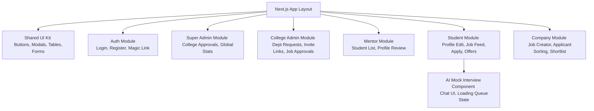

# DOCUMENT 14: Component Diagram

### **14.1 Frontend Module Boundaries**

To prevent merge conflicts and accommodate the mixed-skill team, the frontend is strictly divided into domain modules. A junior dev can be assigned entirely to the **`CompanyModule`** without ever touching **`StudentModule`**.

### **14.2 Backend Component Boundaries**

- **Auth Handler:** Manages JWT validation and session refresh using Supabase helpers.
- **Eligibility Engine:** A pure TypeScript function. Takes **`StudentProfile`** and **`JobPosting`**, returns **`boolean`** + **`string[]`** (reasons). Easily testable.
- **Offer State Machine:** A dedicated TS module that handles the complex transaction of accepting an offer, auto-withdrawing others, and locking the student profile.
- **AI Proxy Controller:** The only component allowed to talk to the Nvidia API. Handles queueing and rate limit headers.